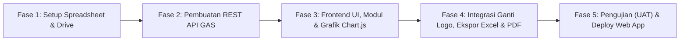

# PRODUCT REQUIREMENTS DOCUMENT (PRD)
## SI-DIKDAS: Sistem Informasi Layanan Pendidikan Dasar
### Dinas Pendidikan dan Kebudayaan Kabupaten Konawe Utara

---

## 1. Ringkasan Eksekutif (Executive Summary)
**SI-Dikdas (Sistem Informasi Layanan Pendidikan Dasar)** adalah aplikasi web portal informasi, pendataan terpadu, visualisasi analitik interaktif, dan pelaporan digital yang dikembangkan khusus untuk Bidang Pendidikan Dasar (Dikdas) Dinas Pendidikan dan Kebudayaan Kabupaten Konawe Utara. 

Aplikasi ini mengintegrasikan dua pilar utama layanan Dikdas:
1. **Seksi Kurikulum**: Pendataan dan monitoring Dana BOSP, Program Indonesia Pintar (PIP), SPMB (Sistem Penerimaan Murid Baru/PPDB), serta distribusi kurikulum/pedoman pendidikan.
2. **Seksi Sarpras (Sarana dan Prasarana)**: Pendataan kondisi fisik bangunan, ruang kelas, laboratorium TIK, mebeler, usulan perbaikan/rehabilitasi, dan pelaporan DAK Fisik/APBD.

Aplikasi ini berbasis **Google Apps Script (GAS)** dengan arsitektur Single Page Application (SPA) murni, memanfaatkan **Google Sheets** sebagai database relasional berkinerja tinggi, **Google Drive** sebagai media penyimpanan berkas/foto bukti fisik, **Chart.js** untuk dasbor grafik interaktif, **fitur ganti logo/branding fleksibel**, serta ekspor instan ke format **Excel (.xlsx)** dan **PDF Ber-Kop Resmi**.

---

## 2. Tujuan Produk & Nilai Bisnis (Product Goals & Business Values)
1. **Sentralisasi Informasi & Layanan**: Mengeliminasi fragmentasi data antara sekolah (SD/SMP se-Konawe Utara) dengan dinas, khususnya pada urusan BOSP, PIP, SPMB, dan usulan Sarpras.
2. **Efisiensi Pendataan Manual**: Menyediakan form input digital terstruktur yang ramah digunakan admin dinas maupun operator sekolah, meminimalisir kesalahan entri manual data berulang.
3. **Visualisasi Data & Monitoring Real-Time (Interactive Analytics Dashboard)**: Menyajikan grafik interaktif multi-dimensi bagi pimpinan (Kadis, Kabid Dikdas, Kasi) untuk memantau tren realisasi BOSP, serapan PIP, dan peta kerusakan sarpras secara instan tanpa perlu membaca ribuan baris spreadsheet mentah.
4. **Kecepatan Pelaporan Administrasi**: Memungkinkan cetak rekapitulasi data format resmi kedinasan dalam hitungan detik (PDF & Excel) tanpa perlu rekapitulasi manual di spreadsheet.
5. **Kemandirian Pengelolaan (Fleksibilitas Branding)**: Pengelola dinas dapat mengubah logo kabupaten/dinas/aplikasi serta teks instansi secara mandiri melalui menu pengaturan portal tanpa menyentuh kode program.

---

## 3. Pengguna Target & Matriks Hak Akses (RBAC yang Disederhanakan: Admin Tunggal)

Untuk kemudahan operasional dan efisiensi pengelolaan, hak akses sistem disederhanakan menjadi **2 Kategori Pengguna** (Publik dan **1 Admin Tunggal** yang memegang kendali penuh):

| Peran Pengguna (Role) | Deskripsi | Hak Akses Utama |
| :--- | :--- | :--- |
| **Publik / Operator Sekolah / Guru / Siswa** | Masyarakat umum, wali murid, dan operator sekolah di wilayah Konawe Utara. | - Mengakses beranda informasi publik & pengumuman. - Melihat grafik statistik publik (sebaran sekolah & kondisi sarpras). - Melacak status penyaluran PIP siswa & juknis SPMB. - Mengunduh formulir, modul kurikulum, & panduan sarpras. - Mengajukan permohonan/laporan sarpras sekolah secara mandiri. |
| **Admin SI-Dikdas (Admin Tunggal)** | Administrator / Pengelola resmi Bidang Dikdas Dinas Dikbud Konawe Utara. | **Akses Penuh Semua Modul (All-in-One):** - Kelola data Kurikulum: Input, edit, validasi BOSP, PIP, & SPMB. - Kelola data Sarpras: Input, edit fisik gedung, verifikasi usulan rehab. - Dasbor grafik analitik lengkap seluruh seksi. - Pengaturan sistem: Ganti Logo (Dinas, Pemkab, Aplikasi) & NIP Pejabat. - Ekspor data ke Excel (.xlsx) & cetak dokumen resmi PDF. |

---

## 4. Arsitektur Data & Integrasi Ekosistem Google Workspace

### A. Struktur Database Google Sheets
Database disimpan dalam satu Google Spreadsheet induk dengan struktur multi-sheet terindeks:

1. **`TB_Config` (Pengaturan Sistem & Ganti Logo)**
   - Kolom: `key`, `value`, `deskripsi`, `updated_at`
   - *Key penting*: `app_name`, `app_tagline`, `logo_utama_url`, `logo_pemkab_url`, `nama_dinas`, `alamat_kantor`, `nama_kadis`, `nip_kadis`, `nama_kabid_dikdas`, `nip_kabid_dikdas`.
2. **`TB_Users` (Manajemen Pengguna)**
   - Kolom: `id_user`, `username`, `password_hash`, `nama_lengkap`, `role` (`ADMIN_UTAMA`), `status_aktif`, `last_login`.
   - *Catatan*: Cukup 1 akun Admin utama (username & password) yang memegang hak akses penuh mengelola Kurikulum, Sarpras, Pengaturan Logo, dan Ekspor Laporan.
3. **`TB_BOSP` (Data Operasional BOSP)**
   - Kolom: `id_bosp`, `tahun_anggaran`, `tahap` (Tahap 1 / Tahap 2), `npsn`, `nama_sekolah`, `jenjang` (SD/SMP), `kecamatan`, `alokasi_dana`, `status_salur` (Diproses / Masuk Rekening / SPJ Selesai), `tgl_cair`, `catatan_spj`, `url_dokumen_spj`.
4. **`TB_PIP` (Data Program Indonesia Pintar)**
   - Kolom: `id_pip`, `tahun`, `nisn`, `nama_siswa`, `nama_sekolah`, `jenjang`, `kelas`, `kecamatan`, `nominal_bantuan`, `status_pencairan` (Belum Aktivasi / Siap Ambil / Sudah Cair), `nama_bank_penyalur`, `keterangan`.
5. **`TB_SPMB` (Penerimaan Peserta Didik Baru)**
   - Kolom: `id_spmb`, `tahun_ajaran`, `npsn`, `nama_sekolah`, `jenjang`, `daya_tampung_total`, `kuota_zonasi`, `kuota_afirmasi`, `kuota_prestasi`, `kuota_pindah`, `kontak_panitia`, `link_juknis_pdf`.
6. **`TB_Sarpras` (Inventaris & Usulan Sarpras)**
   - Kolom: `id_sarpras`, `tgl_pendataan`, `npsn`, `nama_sekolah`, `kecamatan`, `jenis_fasilitas` (Ruang Kelas, Toilet, Lab Komputer, Perpustakaan, Rumah Dinas, Pagar, Mebeler), `kondisi` (Baik, Rusak Ringan, Rusak Sedang, Rusak Berat), `jumlah_unit`, `kebutuhan_penanganan`, `estimasi_biaya`, `status_usulan` (Menunggu Verifikasi, Disetujui DAK, APBD, Ditolak), `foto_sarpras_url`, `url_proposal`.
7. **`TB_Pengumuman` (Informasi & Berita Portal)**
   - Kolom: `id_post`, `tgl_publish`, `judul`, `kategori` (`KURIKULUM`, `SARPRAS`, `UMUM`), `ringkasan`, `isi_konten`, `file_lampiran_url`, `status_tampil`.

### B. Struktur Direktori Google Drive
Folder terpusat `DRIVE_SI_DIKDAS_KONUT/`:
- `01_Branding_Assets/` (Menyimpan logo aplikasi, logo dinas, dan logo daerah hasil upload admin).
- `02_Kurikulum_BOSP_PIP/` (Berkas SPJ BOSP, format modul, dan juknis).
- `03_Sarpras_Dokumentasi/` (Foto-foto kondisi fisik gedung/fasilitas sekolah).

---

## 5. Persyaratan Fungsional (Functional Requirements)

### A. Portal Layanan Informasi (Tampilan Publik)
1. **Header & Identitas Dinamis**: Menampilkan logo dinas, nama aplikasi "SI-Dikdas", dan navigasi cepat yang diperbarui dinamis dari database.
2. **Hero Banner Interaktif**: Pesan sambutan Bidang Dikdas Konawe Utara, kartu pintas cepat (Quick Access) ke Seksi Kurikulum & Seksi Sarpras.
3. **Kanal Layanan Seksi Kurikulum**:
   - Tab informasi BOSP: Alur pencairan, panduan SPJ, checklist berkas.
   - Tab pencarian PIP: Input NISN untuk cek mandiri status pencairan beasiswa PIP siswa.
   - Tab info SPMB: Unduh petunjuk teknis penerimaan siswa baru per jenjang SD & SMP.
4. **Kanal Layanan Seksi Sarpras**:
   - Statistik ringkasan kondisi fasilitas sekolah di Konawe Utara.
   - Formulir usulan sarpras mandiri dari sekolah ke dinas (upload foto kerusakan).
5. **Portal Berita & Unduhan Terpadu**: Daftar surat edaran dinas dan pengumuman dengan tombol unduh langsung.

### B. Modul Visualisasi Grafik Interaktif (Interactive Charts & Analytics)
Menggunakan library **Chart.js** modern dengan animasi halus, tooltip angka detail, dan interaktivitas klik:

1. **Grafik Seksi Kurikulum**:
   - **Diagram Batang Realisasi BOSP**: Perbandingan Pagu Anggaran vs Realisasi Pencairan per Tahap (Tahap 1 & 2) serta komparasi antar jenjang SD vs SMP.
   - **Diagram Donat Status SPJ BOSP**: Persentase sekolah yang SPJ-nya sudah diverifikasi vs masih dalam proses revisi.
   - **Diagram Lingkaran / Bar PIP**: Persentase status pencairan beasiswa PIP (Sudah Cair vs Belum Aktivasi) serta sebaran penerima per jenjang.
2. **Grafik Seksi Sarpras**:
   - **Diagram Pie Kondisi Sarpras Sekolah**: Persentase kondisi fisik fasilitas (Kondisi Baik, Rusak Ringan, Rusak Sedang, Rusak Berat) se-Konawe Utara.
   - **Diagram Batang Kebutuhan Rehab**: Peringkat fasilitas paling mendesak butuh penanganan (Ruang Kelas, Toilet/Sanitasi, Lab Komputer, Mebeler).
   - **Diagram Sebaran per Kecamatan**: Jumlah usulan perbaikan gedung sekolah per kecamatan untuk prioritas DAK Fisik/APBD.
3. **Grafik SPMB**:
   - **Grafik Batang Keterisian Kuota**: Perbandingan daya tampung sekolah vs pendaftar per jalur (Zonasi, Afirmasi, Prestasi, Mutasi).

### C. Portal Admin & Input Manual
1. **Sistem Login Keamanan Bertingkat**: Otentikasi sesi terproteksi dengan pembagian hak akses per seksi.
2. **Dasbor Eksekutif Terpadu**:
   - Kartu KPI metrik utama (Total Sekolah, Total Realisasi BOSP, Total Penerima PIP, Usulan Sarpras Masuk).
   - Panel visualisasi grafik lengkap (BOSP, PIP, Sarpras).
3. **Modul Manajemen Kurikulum (Input Manual & Batch)**:
   - Form input BOSP: Tambah/edit alokasi dana, checklist status berkas SPJ per sekolah.
   - Form input PIP: Tambah per siswa atau upload batch, ubah status pencairan bank.
   - Form input SPMB: Pengaturan daya tampung dan kuota jalur per sekolah.
4. **Modul Manajemen Sarpras (Input Manual & Verifikasi)**:
   - Form pendataan kondisi gedung/ruang per sekolah.
   - Form verifikasi usulan masuk: Mengubah status usulan (*Diterima / Usulan DAK Fisik / Survey Lapangan*).
   - Fitur upload foto kerusakan sarpras langsung dari kamera ponsel atau galeri.
5. **Fitur Ganti Logo & Branding (Menu Pengaturan)**:
   - Form pengaturan profil dinas: Input URL atau upload langsung file logo baru (PNG/JPG/SVG) ke Google Drive.
   - Pembaruan logo seketika di seluruh halaman tanpa perlu restart sistem atau edit kode HTML.
   - Pengaturan tanda tangan digital dan NIP pejabat pada cetakan berkas.
6. **Pusat Ekspor Laporan (Excel & PDF)**:
   - **Ekspor Excel (.xlsx)**: Sekali klik mengunduh tabel data BOSP, PIP, dan Sarpras lengkap dengan filter periode/kecamatan.
   - **Cetak PDF Ber-Kop Resmi**: Otomatis menyusun lembar laporan resmi lengkap dengan kop Dinas PK Konawe Utara, logo instansi, tabel data rapi, serta kolom tanda tangan pejabat penanggung jawab.

---

## 6. Batasan Teknis & Mitigasi Kuota GAS

| Aspek Teknis | Batasan Google Apps Script (GAS) | Solusi Arsitektural SI-Dikdas |
| :--- | :--- | :--- |
| **Batas Waktu Eksekusi** | Maksimal 6 menit per panggilan. | Pola *Lightweight Client-Side Rendering*: GAS murni bertindak sebagai REST API JSON cepat; manipulasi filter, agregasi data grafik, dan visualisasi dieksekusi di browser. |
| **Batas Payload Upload File** | Batasan payload POST string Base64. | Upload foto dan file dioptimalkan dengan kompresi gambar di sisi klien (*Canvas Compressor*) sebelum dikirim ke Google Drive. |
| **Frekuensi Pembacaan Sheets** | Kuota API Google Spreadsheet per hari. | Implementasi caching dua tingkat: **CacheService GAS** di backend dan **LocalStorage** di frontend untuk data referensi statis (daftar sekolah/kecamatan/branding). |
| **Keamanan Kredensial** | Pencegahan kebocoran kata sandi. | Kata sandi pengguna dienkripsi searah (*hash salt*) dan parameter rahasia disimpan di `ScriptProperties`. |

---

## 7. Spesifikasi Tampilan & Antarmuka (UI/UX - Berdasarkan Referensi Visual Cloud-Sky Bento Grid)

Berdasarkan referensi desain visual yang telah disepakati, antarmuka aplikasi SI-Dikdas mengadopsi gaya **Ultra-Modern Sky-Blue Glassmorphism & Bento Grid System**:

### A. Konsep Visual & Karakteristik Utama
1. **Hero Section Berawan 3D (*Sky Horizon with Cloud Vista*)**:
   - Latar belakang biru langit cerah Tut Wuri Handayani (`#0080E6` / `#0084C9`) bergradasi halus menuju cakrawala awan putih (*fluffy realistic clouds*) di bagian bawah hero.
   - **3D Curved Card Deck Carousel**: Deretan kartu fitur interaktif (Statistik BOSP, Kartu Verifikasi PIP Siswa, Foto Sarpras Sekolah, Grafik Kelulusan SPMB) yang melayang melengkung secara 3D (*floating perspective arc*) di atas awan.
   - Headline tipografi putih tegas berskala besar (*display font*), dilengkapi tombol CTA berbentuk pill oval dengan aksen warna kuning-lime cerah (`#E2F952` / `#FFC72C`) dan tombol kaca transparan (*frosted glass button*).
   - Banner Social Proof: *"Melayani 124+ Satuan Pendidikan SD & SMP se-Kabupaten Konawe Utara ★★★★★"*.
2. **Logo Bar Ticker / Partner Marquee**:
   - Deretan logo monokrom abu-abu elegan meluncur horizontal (*infinite logo ticker*): Logo Pemkab Konawe Utara, Kemendikbudristek, Logo Tut Wuri Handayani, BOSP, PIP, dan Kurikulum Merdeka.
3. **Bento Grid Layanan Modern (Bento Box Architecture)**:
   - Judul seksi dengan tipografi modern yang menyisipkan *inline pill icon badge* di tengah kalimat (contoh: *"Layanan Pendidikan Dasar yang Lebih [Icon Biru] Cepat dan [Icon Lime] Transparan"*).
   - Grid bento beraneka ukuran dengan sudut melengkung besar (*border-radius: 28px - 32px*):
     - **Kartu Biru Langit**: Foto profil pimpinan/guru dengan overlay kartu metrik putih melayang (*124+ Sekolah Terkoneksi*).
     - **Kartu Putih Bersih (Commitment Metric)**: Realisasi BOSP 100%, stack avatar operator sekolah, dan kutipan testimoni.
     - **Kartu Aksen Lime-Gold Cerah (`#E2F952`)**: Sorotan data beasiswa PIP (6.420+ Siswa Penerima Aktif).
     - **Kartu Dark Navy Kontras (`#0A2540`)**: Metrik cakupan 13 Kecamatan se-Konawe Utara.
4. **Palet Warna Terintegrasi**:
   - `Primary Sky Azure`: `#0080E6` / `#0084C9` (Biru Langit Segar Tut Wuri Handayani)
   - `Accent Neon Lime-Gold`: `#E2F952` / `#FFC72C` (Warna tombol aksi "Get Started", pill navbar, dan kartu bento highlight)
   - `Deep Navy Dark`: `#0A2540` / `#111827` (Warna kartu bento kontras, teks tajam, dan sidebar portal admin)
   - `Cloud Surface`: `#FFFFFF` (Putih bersih dengan bayangan lembut berkedalaman tinggi)
   - `Canvas Body`: `#F8FAFC` (Latar belakang lembut ramah pembacaan jangka panjang)
5. **Tipografi & Komponen**:
   - Font: `Plus Jakarta Sans` / `Outfit` (Modern, ramah, dan sangat proporsional).
   - Bentuk Tombol: *Full-pill rounded* (rounded-full) dengan icon panah miring (*arrow-up-right ↗*).
   - Navigasi Admin: Sidebar deep navy yang ramping, menyatu dengan dasbor kartu bento dan grafik interaktif Chart.js.

---

## 8. Rencana Deployment & Tahapan Pengujian

1. **Fase 1: Persiapan Basis Data & Folder Drive** (Pembuatan template sheet `TB_Config`, `TB_BOSP`, `TB_PIP`, `TB_Sarpras`, `TB_Users`).
2. **Fase 2: Pemrograman Backend Script (`Kode.gs`)** (Endpoint CRUD, upload drive, agregasi data statistik, generator PDF).
3. **Fase 3: Pemrograman Antarmuka (`Index.html`, `CSS`, `JS`)** (Portal publik, kanal Kurikulum, kanal Sarpras, modul dasbor grafik Chart.js, dan portal admin).
4. **Fase 4: Integrasi Modul Ekspor & Branding** (SheetJS untuk Excel, template cetak PDF resmi, dan live logo customizer).
5. **Fase 5: Pengujian & Publikasi** (Deploy Web App dengan setelan `Execute as: Me`, `Who has access: Anyone`).

---

🎨 **Tahapan Khusus: Penentuan Visual UI/UX**
1. **Unggah Referensi:** Silakan unggah referensi tangkapan layar, warna, atau gaya antarmuka yang Anda sukai jika sudah memiliki contoh.
2. **Jika Belum Ada Referensi Visual:**
   - Salin seluruh teks dokumen PRD Final di atas (atau buka file [PRD_SI_DIKDAS_KONAWE_UTARA.md](file:///c:/Users/Digitalisasi/Documents/APLIKASI%20WEB%20SAHBIN/ANTI%20GRAVITY/APK%20SI%20DIKDAS/PRD_SI_DIKDAS_KONAWE_UTARA.md)).
   - Buka **Google Stitch**, lalu tempelkan teks PRD ke dalamnya untuk menghasilkan konsep tata letak wireframe/mockup.
   - Unduh hasil pratinjau desain visual yang dihasilkan oleh Google Stitch.
   - Unggah gambar hasil desain tersebut ke percakapan ini untuk langsung kita implementasikan ke dalam kode HTML/CSS aplikasi SI-Dikdas!
